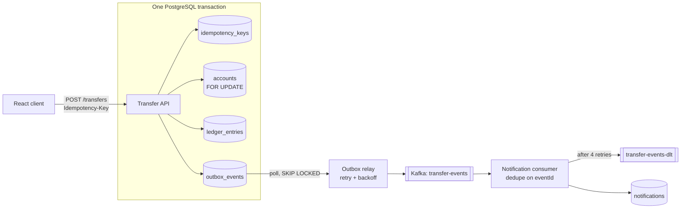

# Kirim: a resilient P2P transfer service

*Kirim* means "send" in Indonesian. This is a small digital-banking backend that moves money between accounts **safely under retries, concurrency and partial failure**, with a React client that shows those guarantees working.

It is built to show the building blocks of resilient back-end systems: **APIs, databases, messaging, idempotency and retries**.

| Area | What's here |
|---|---|
| Back end | Kotlin 2.2, Spring Boot 3.5, Spring JDBC (`JdbcClient`), Flyway |
| Data | PostgreSQL 16: row locking, `ON CONFLICT`, `SKIP LOCKED`, `BIGINT` money |
| Messaging | Kafka: transactional outbox, retries with exponential backoff, dead-letter topic, idempotent consumer |
| API | REST, `Idempotency-Key` header, RFC 9457 Problem Details, OpenAPI / Swagger UI |
| Front end | React 19 + TypeScript + Vite, retry-safe API client |
| Quality | Unit tests written first, Testcontainers integration tests, concurrency tests, Vitest |
| Delivery | Docker multi-stage build, docker-compose, GitHub Actions CI |
| Ops | Actuator health, Micrometer metrics, Prometheus endpoint |

---

## Architecture



### What happens on `POST /api/v1/transfers`

1. **Reserve the idempotency key.** `INSERT ... ON CONFLICT DO NOTHING`. If the key exists, compare the request fingerprint (SHA-256 of the body): same body → **replay** the original transfer (`200`, `Idempotent-Replayed: true`); different body → `422`.
2. **Lock both accounts** with `SELECT ... FOR UPDATE ORDER BY id`. The fixed order means A→B and B→A running at the same time queue instead of deadlocking.
3. **Decide** with `TransferDecision`, a pure function covered by unit tests: approve, or reject with `INSUFFICIENT_FUNDS` / `LIMIT_EXCEEDED` / `CURRENCY_MISMATCH`.
4. **Write** the balances, two ledger entries (DEBIT + CREDIT) and an **outbox event**, all in the same transaction.
5. **Commit.** Either everything happened or nothing did.

Then, asynchronously:

6. The **outbox relay** claims due events (`FOR UPDATE SKIP LOCKED`, so it's safe with many instances), publishes to Kafka with `acks=all` and an idempotent producer, and marks them `PUBLISHED`. On failure it retries with **exponential backoff** (1s, 2s, 4s, … capped at 5m) and parks the event as `FAILED` after `max-attempts`.
7. The **notification consumer** dedupes on `eventId` in the same transaction as its write, so **at-least-once delivery becomes effectively-once**. Failing messages are retried (0.5s → 4s) and then sent to the **dead-letter topic**. Malformed JSON skips the retries.

### Why these choices

| Decision | Why | Alternative considered |
|---|---|---|
| Money as `BIGINT` minor units | No floating-point rounding; IDR has no sub-unit in practice | `NUMERIC`: fine too, but `Long` is simpler end to end |
| Pessimistic locks (`FOR UPDATE`) | Balance updates are highly contended; failing fast and retrying (optimistic) wastes work and complicates the API | Optimistic `version` column |
| Rejections are stored, not thrown | A rejected transfer is a real event: it is audited, published, and replayed identically on retry | Return `4xx` and store nothing |
| Transactional outbox | Avoids the dual-write problem (DB commit OK but Kafka publish lost, or the reverse) | Publish inside the request; CDC with Debezium |
| Plain SQL via `JdbcClient` | Locking and `ON CONFLICT` semantics are explicit and reviewable | JPA/Hibernate |

More detail in [`docs/adr`](docs/adr).

---

## Running it

**Prerequisites:** JDK 21 (or let Gradle download it), Docker, Node 22.

```bash
# 1. Infrastructure
docker compose up -d postgres kafka

# 2. API on :8080 (Flyway creates the schema on startup)
cd backend
./gradlew bootRun            # Windows: .\gradlew.bat bootRun

# 3. Web on :5173 (proxies /api to :8080)
cd ../web
npm install
npm run dev
```

Or run the API in Docker too: `docker compose up --build`.

- Swagger UI: http://localhost:8080/swagger-ui.html
- Health: http://localhost:8080/actuator/health
- Metrics: http://localhost:8080/actuator/prometheus (`kirim_transfers_total`, `kirim_outbox_publish_total`, …)

### Try the API

```bash
# Open two accounts
curl -s -X POST localhost:8080/api/v1/accounts -H 'Content-Type: application/json' \
  -d '{"ownerName":"Alice","openingBalance":1000000}'
curl -s -X POST localhost:8080/api/v1/accounts -H 'Content-Type: application/json' \
  -d '{"ownerName":"Bob"}'

# Send. Run this twice with the same key: money moves once, the second call is a replay.
curl -i -X POST localhost:8080/api/v1/transfers \
  -H 'Content-Type: application/json' -H 'Idempotency-Key: 7b1f-demo-001' \
  -d '{"fromAccountId":"<alice-id>","toAccountId":"<bob-id>","amount":150000,"description":"makan siang"}'
```

PowerShell:

```powershell
$body = @{ fromAccountId = "<alice-id>"; toAccountId = "<bob-id>"; amount = 150000 } | ConvertTo-Json
Invoke-RestMethod -Method Post -Uri http://localhost:8080/api/v1/transfers `
  -Headers @{ "Idempotency-Key" = "7b1f-demo-001" } -ContentType "application/json" -Body $body
```

In the web UI, **Double-tap** fires two requests with the same key at once. Both responses show the same transfer ID, one of them marked `replayed`, and the statement shows a single debit.

---

## Tests

```bash
cd backend && ./gradlew test   # needs Docker running (Testcontainers)
cd web && npm test
```

| Test | Proves |
|---|---|
| `TransferDecisionTest` | Business rules: exact-balance sends, limits, currency, overflow (pure unit, ms) |
| `RequestFingerprintTest`, `BackoffTest` | Idempotency fingerprinting; backoff doubles and caps |
| `TransferApiIntegrationTest` | HTTP contract: 201 / 200 replay / 422 key reuse / 404 / 400 problem details; ledger matches balances |
| `ConcurrentTransferIntegrationTest` | 200 random transfers on 16 threads: **no deadlocks, no money created or lost, no negative balances**; 10 concurrent calls with one key → **exactly one transfer** |
| `OutboxRelayIntegrationTest` | Retry timing with a controllable clock; `FAILED` after max attempts; transient failures recover |
| `TransferEventFlowIntegrationTest` | Real Kafka end to end; duplicate delivery does not duplicate notifications |
| `retry.test.ts` | Client retries 5xx/409/429/network errors with backoff, never 4xx |

Integration tests run against **real PostgreSQL and Kafka** in Docker (Testcontainers), not H2 or mocks, because locking and `ON CONFLICT` behaviour is exactly what's being tested.

---

## Project layout

```
backend/src/main/kotlin/dev/rendy/kirim/
  account/       accounts, ledger, statement API
  transfer/      TransferDecision (pure rules), TransferService (the transaction), idempotency
  outbox/        outbox table, relay + backoff, Kafka publisher
  notification/  Kafka consumer (idempotent), notifications API
  common/        Problem Details error handling, JDBC helpers
  config/        Kafka topics + error handler / DLT, OpenAPI, CORS, Clock
backend/src/main/resources/db/migration/   Flyway SQL
web/src/api/     typed client + retry helper (tested)
web/src/App.tsx  accounts, send / double-tap, statement, live notifications
docs/adr/        architecture decision records
```

## Roadmap

- [ ] Auth: JWT resource server + account-ownership checks
- [ ] Flutter client using the same idempotent retry pattern
- [ ] Daily limits per account (needs a running total, not just a per-transfer cap)
- [ ] Clean up old idempotency keys (TTL job) and add a replay endpoint for `FAILED` outbox events
- [ ] Distributed tracing (OpenTelemetry) across HTTP → outbox → Kafka
- [ ] Contract tests for the `TransferEvent` schema (e.g. Avro + schema registry)
