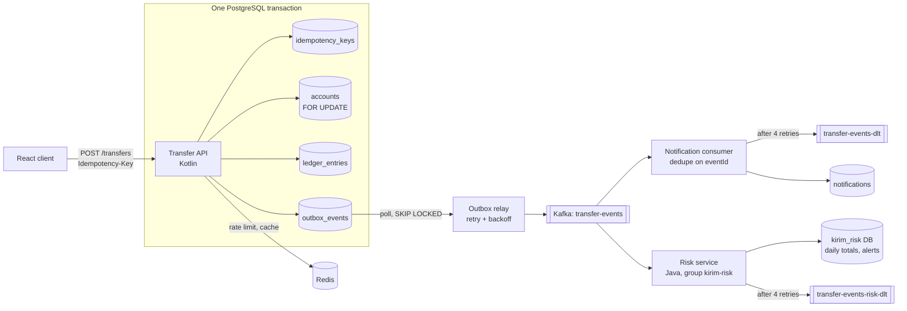

# Kirim: a resilient P2P transfer service

*Kirim* means "send" in Indonesian. This is a small digital-banking backend that moves money between accounts **safely under retries, concurrency and partial failure**, with a React client that shows those guarantees working.

It is built to show the building blocks of resilient back-end systems: **APIs, databases, messaging, idempotency and retries**, split into two services (Kotlin and Java) and deployable to **Kubernetes** with **GitLab CI/CD**.

| Area | What's here |
|---|---|
| Back end | Transfer API: Kotlin 2.2, Spring Boot 3.5, Spring JDBC (`JdbcClient`), Flyway |
| Risk service | **Java 21**, Spring Boot 3.5: AML-style alerts from transfer events, own database |
| Data | PostgreSQL 16: row locking, `ON CONFLICT`, `SKIP LOCKED`, `BIGINT` money |
| Messaging | Kafka: transactional outbox, retries with exponential backoff, dead-letter topics, idempotent consumers, two consumer groups |
| Caching | Redis: per-account rate limiting (Lua, shared across replicas), cache-aside for immutable transfers, fails open |
| API | REST, `Idempotency-Key` header, RFC 9457 Problem Details, OpenAPI / Swagger UI |
| Front end | React 19 + TypeScript + Vite, retry-safe API client |
| Quality | Unit tests written first, Testcontainers integration tests, concurrency tests, Vitest |
| Delivery | Docker multi-stage builds, docker-compose, **Kubernetes** (Kustomize), **GitLab CI/CD** (test, build, deploy), GitHub Actions |
| Security | Keycloak (OpenID Connect), Spring Security resource servers (JWT), account ownership checks, OPS role, PKCE login in the web app |
| Edge | Nginx reverse proxy: one entry point, `X-Request-Id`, per-IP rate limits, actuator hidden |
| Ops | Liveness/readiness/startup probes, Micrometer metrics, Prometheus endpoint, non-root read-only containers |

---

## Architecture



### What happens on `POST /api/v1/transfers`

1. **Reserve the idempotency key.** `INSERT ... ON CONFLICT DO NOTHING`. If the key exists, compare the request fingerprint (SHA-256 of the body): same body → **replay** the original transfer (`200`, `Idempotent-Replayed: true`); different body → `422`.
2. **Rate limit** the sending account in Redis (10 new transfers per minute by default). Over the limit → `429` with `Retry-After`, and the key reservation rolls back. Replays (step 1) never count.
3. **Lock both accounts** with `SELECT ... FOR UPDATE ORDER BY id`. The fixed order means A→B and B→A running at the same time queue instead of deadlocking.
4. **Decide** with `TransferDecision`, a pure function covered by unit tests: approve, or reject with `INSUFFICIENT_FUNDS` / `LIMIT_EXCEEDED` / `CURRENCY_MISMATCH`.
5. **Write** the balances, two ledger entries (DEBIT + CREDIT) and an **outbox event**, all in the same transaction.
6. **Commit.** Either everything happened or nothing did.

Then, asynchronously:

7. The **outbox relay** claims due events (`FOR UPDATE SKIP LOCKED`, so it's safe with many instances), publishes to Kafka with `acks=all` and an idempotent producer, and marks them `PUBLISHED`. On failure it retries with **exponential backoff** (1s, 2s, 4s, … capped at 5m) and parks the event as `FAILED` after `max-attempts`.
8. The **notification consumer** dedupes on `eventId` in the same transaction as its write, so **at-least-once delivery becomes effectively-once**. Failing messages are retried (0.5s → 4s) and then sent to the **dead-letter topic**. Malformed JSON skips the retries.
9. The **risk service** reads the same topic in its own consumer group, adds the transfer to the sender's daily totals (Jakarta business day, one atomic upsert) and raises alerts: `LARGE_TRANSFER`, `DAILY_TOTAL_EXCEEDED`, `HIGH_DAILY_COUNT`.
10. Every night at 01:30 WIB a **reconciliation** checks that the books add up for the day before: balances = ledger, no money created or lost, every transfer has its two ledger legs and one delivered event. It reads one `REPEATABLE READ` snapshot, stores every run and mismatch (`/api/v1/reconciliations`), and runs once even with several replicas ([ADR 0007](docs/adr/0007-daily-reconciliation.md)).

`GET /api/v1/transfers/{id}` reads Redis first, then PostgreSQL (cache-aside). Transfers never change after commit, so the cache never needs invalidating.

### Why these choices

| Decision | Why | Alternative considered |
|---|---|---|
| Money as `BIGINT` minor units | No floating-point rounding; IDR has no sub-unit in practice | `NUMERIC`: fine too, but `Long` is simpler end to end |
| Pessimistic locks (`FOR UPDATE`) | Balance updates are highly contended; failing fast and retrying (optimistic) wastes work and complicates the API | Optimistic `version` column |
| Rejections are stored, not thrown | A rejected transfer is a real event: it is audited, published, and replayed identically on retry | Return `4xx` and store nothing |
| Transactional outbox | Avoids the dual-write problem (DB commit OK but Kafka publish lost, or the reverse) | Publish inside the request; CDC with Debezium |
| Plain SQL via `JdbcClient` | Locking and `ON CONFLICT` semantics are explicit and reviewable | JPA/Hibernate |
| Redis for rate limits and cache only | Shared across replicas; never the source of truth, so a Redis outage degrades instead of breaking transfers | Idempotency in Redis (`SETNX`): can't be atomic with the PostgreSQL write |
| Keycloak + resource servers | Services never see passwords; roles and ownership are checked on every request ([ADR 0008](docs/adr/0008-authentication-with-keycloak.md)) | Login built into the transfer API |
| One Nginx entry point | Same origin for web app, APIs and login; internal endpoints stay internal ([ADR 0009](docs/adr/0009-reverse-proxy.md)) | A port per service |
| Daily reconciliation that reports, never repairs | Catches damage outside the transfer code (manual SQL, bugs, stuck events); fixing money stays a human decision | Trusting the code alone; auto-correcting balances |
| Separate risk service, Kafka-only input | Detection must not slow down or fail transfers; database per service | Checks inside the transfer transaction |

More detail in [`docs/adr`](docs/adr).

---

## Running it

**Prerequisites:** JDK 21 (or let Gradle download it), Docker, Node 22.

```bash
# 1. Infrastructure
docker compose up -d postgres kafka redis

# 2. API on :8080 (Flyway creates the schema on startup)
cd backend
./gradlew bootRun            # Windows: .\gradlew.bat bootRun

# 3. Web on :5173 (proxies /api to :8080)
cd ../web
npm install
npm run dev

# 4. (optional) Risk service on :8081
cd ../risk-service
./gradlew bootRun
```

Or run everything in Docker: `docker compose up --build`.

- Swagger UI: http://localhost:8080/swagger-ui.html
- Health: http://localhost:8080/actuator/health
- Metrics: http://localhost:8080/actuator/prometheus (`kirim_transfers_total`, `kirim_outbox_publish_total`, `kirim_ratelimit_total`, `kirim_cache_total`, …)
- Risk service: http://localhost:8081/api/v1/alerts, `/api/v1/accounts/{id}/daily-activity`, Swagger at http://localhost:8081/swagger-ui.html

Try every feature from PowerShell: see [scripts/demo](scripts/demo/README.md).

With `docker compose up --build -d` everything is behind the reverse proxy: web app at http://localhost (log in as `alice` / `alice`, `bob` / `bob`, or `ops` / `ops`), API under http://localhost/api, Swagger at http://localhost/swagger-ui.html (click **Authorize** and paste a token, e.g. from `Get-KirimToken alice` in the demo scripts), Keycloak admin at http://localhost/auth/admin (`admin` / `admin`). For `npm run dev` on :5173, put `VITE_KEYCLOAK_URL=http://localhost/auth` in `web/.env.local`.

### Try the API

```bash
# Open two accounts
curl -s -X POST localhost:8080/api/v1/accounts -H 'Content-Type: application/json' \
  -d '{"ownerName":"Alice","openingBalance":1000000}'
curl -s -X POST localhost:8080/api/v1/accounts -H 'Content-Type: application/json' \
  -d '{"ownerName":"Bob"}'

# Send. Run this twice with the same key: money moves once, the second call is a replay.
curl -i -X POST localhost:8080/api/v1/transfers \
  -H 'Content-Type: application/json' -H 'Idempotency-Key: 7b1f-demo-001' \
  -d '{"fromAccountId":"<alice-id>","toAccountId":"<bob-id>","amount":150000,"description":"makan siang"}'
```

PowerShell:

```powershell
$body = @{ fromAccountId = "<alice-id>"; toAccountId = "<bob-id>"; amount = 150000 } | ConvertTo-Json
Invoke-RestMethod -Method Post -Uri http://localhost:8080/api/v1/transfers `
  -Headers @{ "Idempotency-Key" = "7b1f-demo-001" } -ContentType "application/json" -Body $body
```

In the web UI, **Double-tap** fires two requests with the same key at once. Both responses show the same transfer ID, one of them marked `replayed`, and the statement shows a single debit.

---

---

## Running on Kubernetes

Manifests are in [`deploy/k8s`](deploy/k8s): a Kustomize base (API, risk service, PostgreSQL, Kafka, Redis) and two overlays.

```bash
kind create cluster --name kirim
docker build -t kirim-api:dev ./backend
docker build -t kirim-risk-service:dev ./risk-service
kind load docker-image kirim-api:dev kirim-risk-service:dev --name kirim
kubectl apply -k deploy/k8s/overlays/local
kubectl -n kirim get pods -w
kubectl -n kirim port-forward svc/kirim-api 8080:80
```

What the manifests show: 2 API replicas (safe thanks to `SKIP LOCKED` and Redis-shared rate limits), rolling updates with `maxUnavailable: 0`, a `PodDisruptionBudget`, startup/liveness/readiness probes (readiness = PostgreSQL only), non-root read-only containers, and config/secrets via Kustomize generators. PostgreSQL, Kafka and Redis are single-instance development setups; see [ADR 0006](docs/adr/0006-kubernetes-and-gitlab-ci.md).

## CI/CD

- **GitLab CI** ([`.gitlab-ci.yml`](.gitlab-ci.yml)): `test` (both Gradle builds with Testcontainers on Docker-in-Docker, web, manifest render) → `build` (images tagged with the commit SHA, pushed to the GitLab registry) → `deploy` (manual, via the GitLab agent for Kubernetes, waits for `rollout status`). Needs a `KUBE_CONTEXT` variable and a `gitlab-deploy-token` deploy token.
- **GitHub Actions** ([`.github/workflows/ci.yml`](.github/workflows/ci.yml)): the same builds and tests on every push.

## Tests

```bash
cd backend && ./gradlew test        # needs Docker running (Testcontainers)
cd risk-service && ./gradlew test   # same
cd web && npm test
```

| Test | Proves |
|---|---|
| `TransferDecisionTest` | Business rules: exact-balance sends, limits, currency, overflow (pure unit, ms) |
| `RequestFingerprintTest`, `BackoffTest` | Idempotency fingerprinting; backoff doubles and caps |
| `TransferApiIntegrationTest` | HTTP contract: 201 / 200 replay / 422 key reuse / 404 / 400 problem details; ledger matches balances |
| `ConcurrentTransferIntegrationTest` | 200 random transfers on 16 threads: **no deadlocks, no money created or lost, no negative balances**; 10 concurrent calls with one key → **exactly one transfer** |
| `OutboxRelayIntegrationTest` | Retry timing with a controllable clock; `FAILED` after max attempts; transient failures recover |
| `TransferEventFlowIntegrationTest` | Real Kafka end to end; duplicate delivery does not duplicate notifications |
| `TransferRateLimiterIntegrationTest` | Real Redis, controlled clock: limit per window, window rollover, per-account isolation, TTL always set, fail-open / fail-closed / disabled |
| `RateLimitApiIntegrationTest` | `429` + `Retry-After` problem details; replays use no quota; a limited request doesn't burn its idempotency key |
| `SecurityIntegrationTest` | 401 without a token; 403 without a role; accounts belong to the caller; customers see only their own accounts (others 404); sending only from your own account, OPS may look but not move money; transfer visibility; OPS-only reconciliation |
| `ReconciliationIntegrationTest` | Correct books match; a hand-edited balance, a missing ledger leg, a rejected transfer with entries, failed/missing/stale events are each named; only the business day's transfers are checked; the nightly run happens once across replicas; HTTP API |
| `TransferCacheIntegrationTest` | Nothing cached inside the write transaction; miss then hit; cached copy equals the DB row; 404s not cached |
| `RiskRulesTest` (Java) | Each AML rule at its threshold; daily alerts fire once at the crossing; Jakarta day boundary |
| `RiskEventFlowIntegrationTest` (Java) | Real Kafka: alerts and daily totals, duplicate delivery counted once, rejected transfers ignored, poison message → risk DLT without blocking the partition |
| `retry.test.ts` | Client retries 5xx/409/429/network errors with backoff, never 4xx |

Integration tests run against **real PostgreSQL, Kafka and Redis** in Docker (Testcontainers), not H2 or mocks, because locking and `ON CONFLICT` behaviour is exactly what's being tested.

---

## Project layout

```
backend/src/main/kotlin/dev/rendy/kirim/
  account/       accounts, ledger, statement API
  transfer/      TransferDecision (pure rules), TransferService (the transaction), idempotency
  outbox/        outbox table, relay + backoff, Kafka publisher
  notification/  Kafka consumer (idempotent), notifications API
  ratelimit/     Redis rate limiter (Lua fixed window)
  reconciliation/ nightly reconciliation: SQL checks on one snapshot, runs + mismatches, API
  common/        Problem Details error handling, JDBC helpers
  config/        Kafka topics + error handler / DLT, OpenAPI, CORS, Clock
backend/src/main/resources/db/migration/   Flyway SQL
risk-service/src/main/java/dev/rendy/kirim/risk/
  rules/         RiskRules (pure, unit tested), thresholds
  event/         TransferEvent contract, Kafka listener
  store/         daily totals upsert, alerts (JdbcClient)
  api/           alerts and daily-activity endpoints
deploy/k8s/      Kustomize base + overlays (local kind, GitLab deploy)
.gitlab-ci.yml   test → build → deploy pipeline
web/src/api/     typed client + retry helper (tested)
web/src/App.tsx  accounts, send / double-tap, statement, live notifications
docs/adr/        architecture decision records
```

## Roadmap

- [ ] Auth: JWT resource server + account-ownership checks
- [ ] Flutter client using the same idempotent retry pattern
- [ ] Daily limits per account (needs a running total, not just a per-transfer cap)
- [ ] Clean up old idempotency keys (TTL job) and add a replay endpoint for `FAILED` outbox events
- [ ] Distributed tracing (OpenTelemetry) across HTTP → outbox → Kafka
- [ ] Contract tests for the `TransferEvent` schema (e.g. Avro + schema registry)
